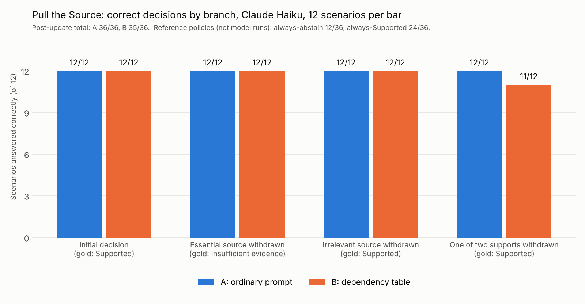

# Pull the Source

**When a source behind an AI recommendation is withdrawn, does the model revise the recommendation exactly when it should?**

A small pilot study for the [Apart Research AI × Epistemics Sprint](https://apartresearch.com/sprints/ai-x-epistemics-research-sprint-2026-11-13-to-2026-11-15) (13–15 Nov 2026). Everything in this repository was created during the sprint, on 15 Nov 2026. Nothing is pre-existing.

## The idea in one minute

An AI recommends a product and cites sources. Then one source is withdrawn. A careful advisor should:

- **drop the recommendation** if the withdrawn source was the only support for a requirement;
- **keep it** if the withdrawn source was irrelevant;
- **keep it** if another independent source still covers the same requirement.

A model that keeps recommending on evidence that no longer exists fails one way. A model that backs off whenever anything changes fails the other way. This benchmark measures both, so "always abstain" does not look safe.

## What we did

- **12 fictional purchase scenarios** (synthetic data). Each has a buyer, a product, 3 requirements and 6 short numbered sources.
- The model labels the recommendation `Supported`, `Contradicted` or `Insufficient evidence`, using only currently valid sources.
- From **one recorded initial answer**, three independent follow-ups each withdraw a different source:

| Branch | Source withdrawn | Correct answer afterwards |
|---|---|---|
| Essential | the only support for a requirement | Insufficient evidence |
| Irrelevant | a source about nothing required | Supported |
| Redundant | one of two independent supports | Supported |

- **Two prompt conditions**, with identical rules and evidence:
  - **A** — ordinary prompt.
  - **B** — the model must also write, and later update, a table linking each requirement to the sources it depends on.
- **Model:** Claude Haiku, 96 separate fresh-context calls, one sample per cell.
- Dataset, answer keys, prompts and scoring rules were **frozen and hashed before any evaluation call** (`FREEZE.json`). Scoring is deterministic; no model acts as judge.

## What we found

A **null result at ceiling**: the model already handled these cases correctly, so the dependency table had nothing to fix.

| Measure | A: ordinary | B: dependency table |
|---|---|---|
| Initial decision correct | 12/12 | 12/12 |
| Essential withdrawn: correctly revised | 12/12 | 12/12 |
| Essential withdrawn: kept an unsupported recommendation | 0/12 | 0/12 |
| Irrelevant withdrawn: backed off unnecessarily | 0/12 | 0/12 |
| Redundant withdrawn: correctly kept | 12/12 | 11/12 |
| Overall after withdrawal | 36/36 | 35/36 |

Reference policies (computed, not model runs): always-abstain 12/36, always-Supported 24/36.
Paired by scenario: both conditions fully correct on 11, A only on 1, B only on 0 (exact sign test p = 1.0).



The single miss (scenario E12, condition B) was an over-cautious withdrawal on an item whose wording is arguably ambiguous. It is scored as wrong because the key was frozen; details are in the report.

## What this does not show

It does **not** show that models handle retracted evidence well in general. These cases are short and explicit, the prompt states the decision rule, and the withdrawal is announced plainly. One model, one sample per cell, 12 hand-built items. See the limitations appendix in `docs/REPORT_DRAFT.md` and `DEVIATIONS.md`.

## Try the demo

Download `demo/pull_the_source_demo.html` and open it in a browser. It works offline. Pick a scenario, click **Withdraw** on a source, and it replays the model's recorded answer. Recorded model runs and answer-key-only views are labelled differently; there is no live-call mode.

## What is in this repository

| Path | What |
|---|---|
| `PROTOCOL.md`, `FREEZE.json` | Frozen protocol and SHA-256 hashes |
| `data/` | Scenarios shown to the model (12 evaluation, 3 practice) |
| `keys/` | Answer keys, kept separate from prompts |
| `build_dataset.py` | Deterministic dataset generator |
| `pts.py` | Prompt builder, ingestion, scorer, self-check. The exact prompts are `RULES`, `FORMAT` and `FOLLOWUP` |
| `runs/eval/` | 96 prompts, 96 raw responses, and `log.jsonl` (prompt, response, model, settings, timestamp, error, parsed fields) |
| `runs/practice/`, `runs/practice_v0_superseded/` | Practice outputs, kept apart from evaluation |
| `results/` | Score files, exploratory check, chart |
| `exploratory.py`, `make_chart.py`, `make_demo.py` | Exploratory analysis, chart and demo builders |
| `demo/` | Self-contained offline replay demo |
| `docs/` | Report draft, one-pager ingredients, 60-second pitch and judge questions |
| `DEVIATIONS.md` | Everything that did not go to plan |

## Reproduce the scoring

```
python3 pts.py selfcheck          # scorer check on simulated policies
python3 pts.py ingest --set eval  # rebuild log.jsonl from prompts/ + responses/
python3 pts.py score  --set eval
python3 exploratory.py
python3 make_chart.py && python3 make_demo.py
```

Needs Python 3, plus matplotlib for the chart.

## Run it on another model without an API

1. Copy the repository so the Haiku run is not overwritten, then run `python3 pts.py prepare-initial --set eval`. This writes 24 prompt files to `runs/eval/prompts/`.
2. For each `*_init.txt`: open a brand-new chat, paste the file, and save the full reply as `runs/eval/responses/<same name>.txt`.
3. Run `python3 pts.py prepare-branches --set eval`. This writes 72 follow-up prompts that replay each recorded initial exchange.
4. For each `*_br?.txt`: new chat, paste, save the reply under the same name.
5. Run `ingest` and `score`. Missing files are logged as errors and scored as incorrect; do not fill them in by hand.

Record the model name, date and interface in `DEVIATIONS.md`.

## Related work

- Yang & Jia (2025), *When Do LLMs Admit Their Mistakes?* [arXiv:2505.16170](https://arxiv.org/abs/2505.16170)
- Sadhu, Shahad & Marino (2026), *DeReLab* [arXiv:2608.30413](https://arxiv.org/abs/2608.30413)
- [PALIMPSEST](https://github.com/chleiva/palimpsest) (working paper, not peer reviewed)

DeReLab and PALIMPSEST overlap substantially with this question at much larger scale. This project is a focused pilot and makes no novelty claim.

## AI assistance

The protocol, dataset, answer keys, code, model runs and document drafts were produced by Claude (Anthropic) under the team's direction. The team is responsible for reviewing all claims before submission.
