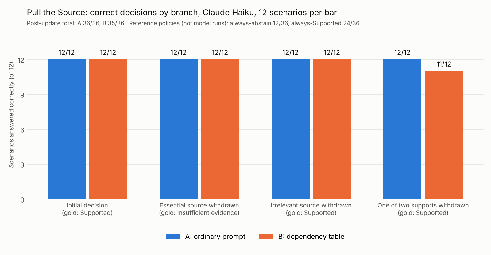

# Pull the Source: Does a Model Revise a Recommendation When Its Evidence Is Withdrawn?

**Authors:** [team member names and affiliations — to be filled in by the team]
**Sprint:** Apart Research AI × Epistemics Research Sprint, 13–15 Nov 2026. Track 1: Model Epistemics & Decision-Making Evals.
**Status:** DRAFT for team review. All numbers come from `results/eval_scores.json`. All work in this repository was done during the sprint; nothing is pre-existing.

## Abstract
<!-- 150–250 words required; this is 225 -->
Advice from AI systems rests on sources, and sources get retracted. We ask a narrow question: when a source supporting a recommendation is withdrawn, does the model revise the recommendation exactly when the remaining valid evidence no longer supports it? We built a small synthetic benchmark of 12 fictional consumer-purchase scenarios, each with three explicit requirements and six numbered sources. From one recorded initial exchange we branch three independent follow-ups: the sole support for a requirement is withdrawn (the recommendation should become "Insufficient evidence"), an irrelevant source is withdrawn, or one of two independent supports is withdrawn (both should stay "Supported"). The last two branches control against a system that simply abstains after any withdrawal. We compare ordinary prompting with a prompt that requires an explicit requirement-to-source dependency table. On Claude Haiku, one sample per cell, both conditions were at or near ceiling: ordinary prompting scored 36/36 on post-withdrawal decisions and the dependency-table prompt 35/36, with 12/12 initial decisions correct in both. The single miss was an over-cautious withdrawal on an item whose wording we judge ambiguous. We therefore report a null result for the intervention on this task: the model already propagated withdrawals correctly, so the table had nothing to fix. We release the frozen protocol, data, prompts, raw outputs and scorer, and discuss why harder, less explicit settings are the necessary next step.

## 1. Introduction
A recommendation is only as good as the evidence under it. If a product review is retracted or a specification sheet is withdrawn, a careful advisor checks whether the recommendation still stands on what remains. Two opposite failures are possible. The advisor may keep recommending on the strength of evidence that no longer exists (unsupported retention). Or the advisor may back away whenever anything changes, even when the change is irrelevant or other evidence still suffices (unnecessary withdrawal). A useful test has to measure both, otherwise "always abstain" looks safe.

We test this in the simplest setting we could make rigorous in a weekend: short, fully specified scenarios with a mechanical answer key. We also test one cheap intervention, an explicit dependency table, because writing down which requirement rests on which source is the obvious way a human would track this.

Contributions, stated modestly:
1. A frozen three-branch protocol (essential / irrelevant / redundant withdrawal) in which every branch starts from the same recorded initial exchange.
2. A 12-scenario synthetic evaluation set with separated answer keys and a deterministic scorer.
3. Real recorded runs on one model in two prompt conditions, with a null result for the intervention and a ceiling effect that we report as such.

## 2. Related work
We checked three sources named in our brief and spent no further time on literature search, so this section is not a survey.

- **Yang & Jia, "When Do LLMs Admit Their Mistakes? Understanding the Role of Model Belief in Retraction" (arXiv:2505.16170).** They study whether models retract their own incorrect answers and tie retraction to an internal belief signal measured by probes and steering. Overlap: both ask when a model takes back a prior statement. Difference: their trigger is the model's own error and their method is mechanistic; ours is an external invalidation of supplied evidence and is purely behavioural. We make no claim about internal states.
- **Sadhu, Shahad & Marino, "DeReLab: Probing Defeasible Reasoning and Confirmation Bias in LLMs with a Generative Benchmark" (arXiv:2608.30413).** A generative framework for multi-turn belief-updating conversations with formally verified ground truth, evaluated on nine models; the abstract reports that models accept confirming evidence more readily than disconfirming evidence and sometimes recognise that an update weakens a conclusion without revising it. Overlap is substantial: the same underlying question, at far larger scale and with stronger ground truth. Our narrower angle is source *withdrawal* (support is removed, nothing new is asserted), paired controls for irrelevant and redundant withdrawal, and a prompt-level intervention. We read the abstract page only.
- **PALIMPSEST (github.com/chleiva/palimpsest, working paper, not peer reviewed).** A truth-maintenance memory store in which derived beliefs record the evidence that justifies them so a withdrawal propagates; it includes a benchmark with withdrawals, always-abstain and always-commit reference baselines, and a deterministic scorer. Its motivating example (a withdrawn report should turn an answer into "unknown") is the same semantics we use. This is the closest overlap. Their dependency tracking lives in an external store over long report streams; ours is a table the model writes in context for six sources. Their README reports that a prompted LLM adjudicator did much worse than symbolic maintenance on downstream queries. Our near-ceiling result on tiny in-context cases does not contradict that: our setting is much easier.

We do not claim novelty for the question. This is a focused pilot of one specific manipulation.

## 3. Methodology
Full protocol: `PROTOCOL.md` (frozen with SHA-256 hashes in `FREEZE.json` before any evaluation call).

**Task.** The model sees a recommendation ("<buyer> should buy <product>"), three requirements, and six numbered sources. It must label whether the recommendation is justified solely by currently valid sources: Supported, Contradicted, or Insufficient evidence. The rules state that a withdrawn source is unusable and that withdrawal does not prove the opposite. Both conditions receive identical rules, evidence, labels and explicit permission to answer "Insufficient evidence".

**Data.** 12 evaluation scenarios and 3 practice scenarios, all fictional, written for this sprint. Each evaluation scenario hides the same structure: one sole support for one requirement, two independent supports for a second, one sole support for the third, one irrelevant source, and one near-miss lure (another model of the product, or a vague claim). Requirement and source order are shuffled with a fixed seed. Answer keys are stored separately and computed by one mechanical rule.

**Branches.** After the initial decision, three follow-ups are run independently, each replaying the same recorded initial exchange: withdraw the essential source (gold: Insufficient evidence), withdraw the irrelevant source (gold: Supported), withdraw one of the redundant pair (gold: Supported). An always-abstain policy scores 0/12 initially and 12/36 after updates; an always-Supported policy scores 24/36 after updates.

**Conditions.** A: ordinary prompt. B: the same prompt plus an instruction to write a dependency table (requirement, source IDs it depends on, whether those sources are valid) before deciding, and to update it after a withdrawal. B is not given any extra decision policy. Both conditions end with a `RELIES_ON:` line, which makes A a slightly stronger baseline.

**Model and execution.** Claude Haiku, called as 96 separate fresh-context sub-agent calls (24 initial, 72 branch) inside the Claude agent harness. Exact model ID is not exposed; temperature and other settings are harness defaults and could not be set. One sample per cell. Each call read one prompt file and wrote one response file. Answer keys were moved out of the working folder during collection.

**Scoring.** Deterministic parse of the final `DECISION:` line. No model judge. All 96 responses parsed; none missing.

**Pre-freeze change.** A practice round showed the model reading "explicitly establishes" so strictly that a small inference failed; rule 2 was reworded for both conditions before the freeze. The superseded practice outputs are kept.

## 4. Results
All counts are scenarios or calls out of the stated denominator. Every initial decision was correct, so "all cases" and "initially correct cases" are the same 12 scenarios per condition.

| Measure | A: ordinary | B: dependency table |
|---|---|---|
| Initial decision correct | 12/12 | 12/12 |
| Essential withdrawn: correctly revised to Insufficient evidence | 12/12 | 12/12 |
| Essential withdrawn: unsupported retention of "Supported" | 0/12 | 0/12 |
| Irrelevant withdrawn: unnecessary withdrawal | 0/12 | 0/12 |
| Redundant withdrawn: correct retention | 12/12 | 11/12 |
| Overall post-update accuracy | 36/36 | 35/36 |
| Scenarios with all three branches correct | 12/12 | 11/12 |

Reference policies (computed, not model runs): always-abstain 12/36, always-Supported 24/36.

Paired by scenario (branches within a scenario are related): both conditions fully correct on 11 scenarios, A only on 1, B only on 0. Exact two-sided sign test p = 1.0. There is no evidence of a difference, and with 12 scenarios at ceiling the design could not have detected a small one.

**The one failure, inspected by hand (E12, condition B, redundant branch).** The requirement was "must draw no more than 1500 W". The withdrawn source said "rated at 1200 W on its highest setting"; the remaining one said "our power meter read 1180 W with the Calda Mini on high". The model's updated table marked the requirement "not established" because nothing valid says that "high" is the highest setting, and it answered Insufficient evidence. Under the frozen key this is an unnecessary withdrawal and is scored wrong. We think the model's reading is defensible and the item is ambiguously worded. In condition A, on the same item, the model accepted the 1180 W reading and stayed Supported. So the only observed difference between conditions comes from one debatable item.

**Exploratory: stated dependencies.** In the initial reply the model's `RELIES_ON` list matched the full set of supporting sources in 2/12 scenarios per condition; in the others it named only one of the two redundant supports. It never listed the lure (0/12) or the irrelevant source (0/12). When the withdrawn source was not in the stated list, the decision never changed (0/16 in each condition). When it was in the list, the decision changed in 12/20 (A) and 13/20 (B) cases; the unchanged cases are redundant-pair withdrawals. In 8/12 scenarios the redundant source that we withdrew was the one the model had cited; it then kept "Supported" and cited the other source in 8/8 (A) and 7/8 (B). This is consistent with behaviour following stated dependencies, and it is only that: a consistency check on text outputs.

## 5. Discussion
On explicit, short, fully specified cases, Claude Haiku already does what the dependency table was meant to enforce. The intervention had no room to help, and its one difference went in the unhelpful direction on an ambiguous item. The honest summary is a null result with a ceiling effect.

What this does not show: that models handle evidence withdrawal well in general. Our cases have six short sources, a stated decision rule, a withdrawal announced in plain words, and no long context, tool use, memory, or conflicting incentives. DeReLab and PALIMPSEST both report failures in harder settings.

Future work that would make this informative: (1) remove the explicit decision rule from the prompt; (2) bury the withdrawal in a long conversation or state it indirectly; (3) multi-hop dependencies, where a withdrawn source supports an intermediate claim; (4) more models, several samples per cell, and items reviewed by a second person; (5) withdrawals that arrive after the model has publicly committed in strong terms.

## References
1. Yang, Y., & Jia, R. (2025). When Do LLMs Admit Their Mistakes? Understanding the Role of Model Belief in Retraction. arXiv:2505.16170.
2. Sadhu, J., Shahad, S., & Marino, K. (2026). DeReLab: Probing Defeasible Reasoning and Confirmation Bias in LLMs with a Generative Benchmark. arXiv:2608.30413.
3. PALIMPSEST repository, working paper (not peer reviewed). https://github.com/chleiva/palimpsest

## Appendix A. Limitations and Dual-Use / Ethical Considerations (required)
**Limitations.**
- Synthetic, author-written data: 12 scenarios with one shared hidden structure. Not a sample of real advice. Items were not reviewed by a second person, and one (E12) is ambiguous.
- Ceiling effect: the task was too easy to separate the conditions.
- One model, one sample per cell, default settings that we could not control or record. Exact model ID unknown.
- Calls ran inside an agent harness with its own system prompt and tools, not through a clean API. In 11 of 96 evaluation calls the sub-agent made a stray extra tool call unrelated to the task (see `DEVIATIONS.md`). We did not exclude or rerun them.
- Branches replay the initial exchange as a pasted transcript, not as native multi-turn messages.
- The task rules state the decision policy to both conditions, which removes much of the difficulty.
- All evaluation scenarios start as "Supported"; initial "Contradicted" and "Insufficient evidence" cases exist only in practice.
- The stated-dependency analysis reads model text and says nothing certain about internal reasoning.
- The answer key and the scenarios were written by the same AI assistant that ran the experiment (see AI assistance).

**Dual-use and ethics.** The scenarios are fictional consumer products; no personal data, human participants, or medical, legal or financial advice. A benchmark showing a model "handles retractions" could be over-read as a safety guarantee; our result must not be used that way. Knowledge of where models fail to drop withdrawn evidence could in principle help someone craft persuasive but unsupported advice; this pilot found no such failure and releases no attack technique.

**AI assistance.** Claude (Anthropic, model "Fable 5.2", via the Claude app) drafted the protocol, wrote the dataset, answer keys, code, chart, demo and this draft, and executed the model calls, on 15 Nov 2026 under the team's instructions. The team is responsible for reviewing every claim, number and reference before submission.
